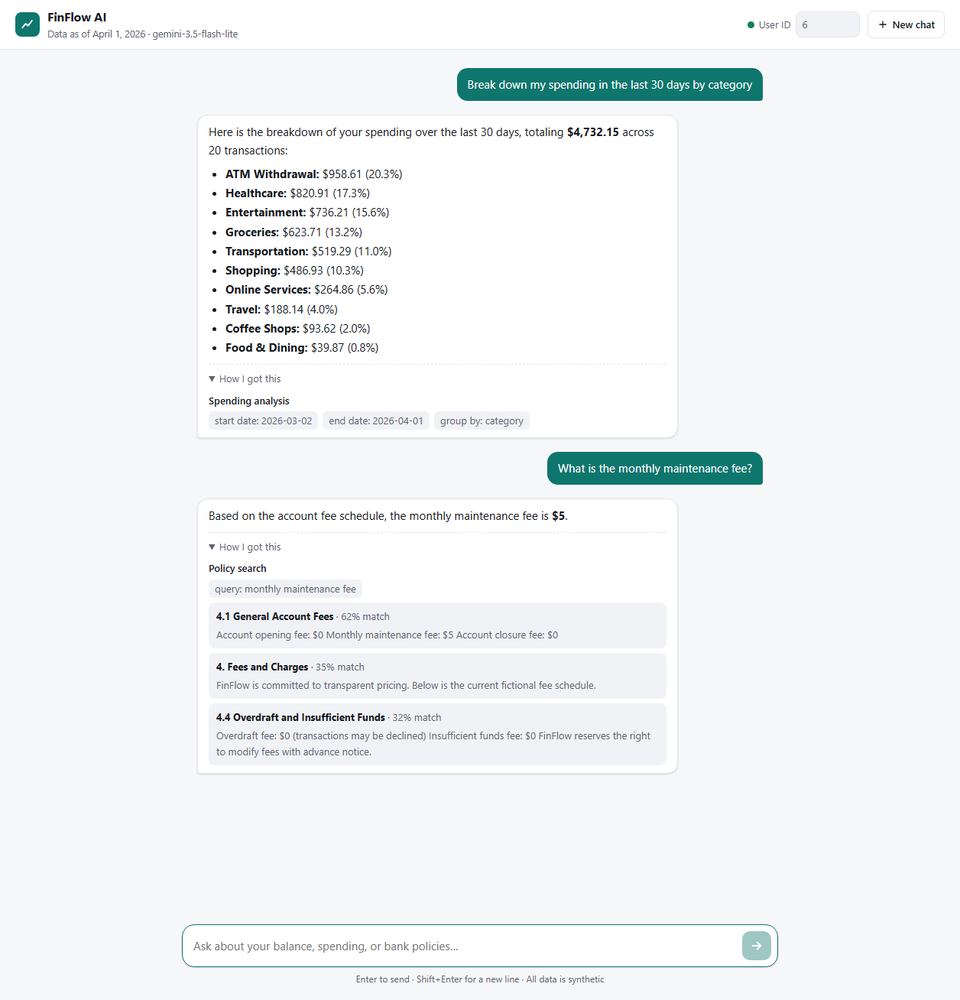
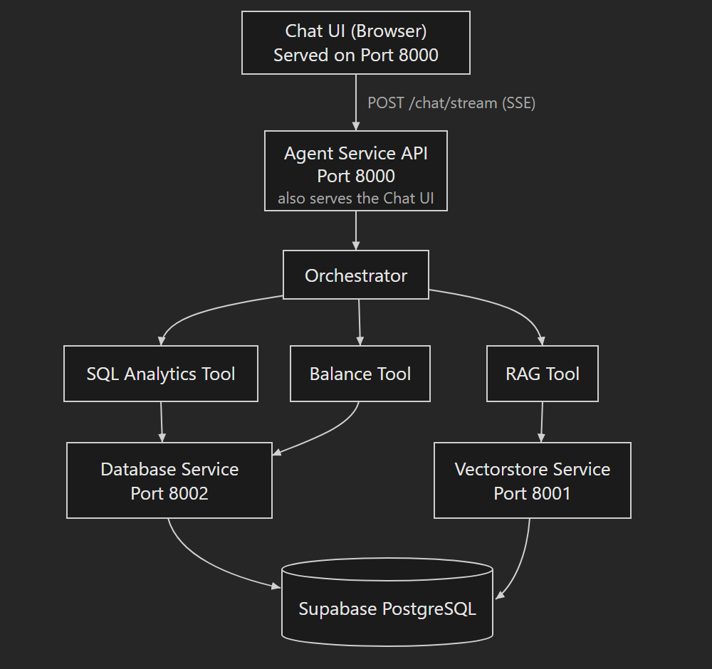
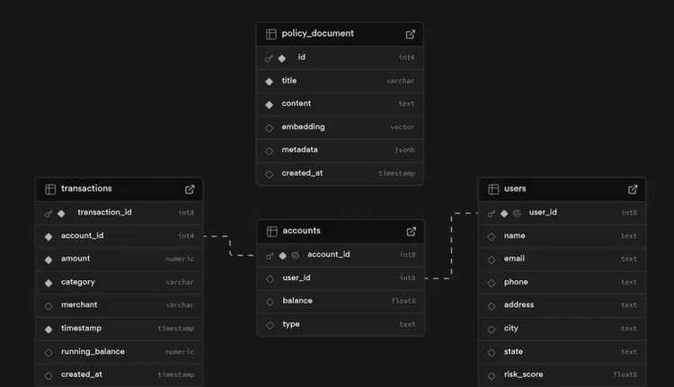

# FinFlow: AI-Powered Digital Banking Assistant

A conversational AI assistant for a fictional digital bank. Ask questions in plain English, such as "How much did I spend on groceries last month?", "What's my savings balance?" or "What's the monthly maintenance fee?", and FinFlow answers from your own account data or from the bank's policy documents.

Built with FastAPI microservices, a LangGraph agent on Google Gemini 3.5 Flash Lite, and retrieval-augmented generation (RAG) over pgvector. All data is synthetic, and the bank is fictional.

<p align="center">
    
</p>

## Features

- **Browser chat UI** at `http://localhost:8000`: streaming answers, follow-up questions that keep context, suggested questions, and a user selector to chat as any of 10,000 synthetic customers
- **Transparent answers**: a **How I got this** panel under each reply shows which tool ran, with what filters, and which policy sections matched
- **Intelligent routing**: a LangGraph agent lets Gemini pick the right tool, or several in parallel, for each question
- **Spending analytics**: totals by category, month, merchant, or account, over any date range
- **Balance lookups** across checking and savings accounts
- **Policy search (RAG)**: semantic search over the bank's terms and fee schedule using `all-MiniLM-L6-v2` embeddings and pgvector
- **Simulated "today"**: generate a year of data ending on any date and have the assistant treat that date as today, so "last month" always means something
- **Synthetic data generation**: 10,000 users, about 20,000 accounts, and 2 million realistic transactions
- **One-command launch on Windows and Linux**, with health checks and clean shutdown

## How It Works

<p align="center">
    
</p>

| Component | Port | Role |
|---|---|---|
| **Chat UI** | 8000 | Single-page chat interface, served by the Agent Service |
| **Agent Service** | 8000 | LangGraph orchestrator: Gemini picks tools, calls them, and writes the answer |
| **Vectorstore Service** | 8001 | Embeds questions and searches the policy document (RAG) |
| **Database Service** | 8002 | Spending analytics, balances, and admin statistics |
| **Supabase PostgreSQL** | n/a | Users, accounts, transactions, and policy embeddings |

When you ask a question, the agent sends it to Gemini along with today's date and your user ID. Gemini chooses one or more tools: **SQL Analytics** (spending), **Balance**, or **RAG** (policy search). The agent calls the matching service, then has Gemini turn the results into a plain-English answer, which streams back to the page.

The chat page is served by the Agent Service itself, so the browser talks only to port 8000. A Streamlit dashboard is planned as a separate frontend (see Roadmap).

See **[docs/ARCHITECTURE.md](docs/ARCHITECTURE.md)** for the full request flow, API endpoints, stream events, and data model.

## Tech Stack

| Area | Technologies |
|---|---|
| Backend | Python 3.12, FastAPI, Uvicorn, httpx |
| AI / ML | LangChain, LangGraph, Google Gemini 3.5 Flash Lite, Hugging Face Transformers, PyTorch, sentence-transformers (all-MiniLM-L6-v2) |
| Database | PostgreSQL (Supabase), pgvector, psycopg2 |
| Frontend | HTML, CSS, and vanilla JavaScript chat page (no build step); Streamlit app planned |
| Data | Faker, python-dotenv, PyYAML |

## Getting Started

### Prerequisites

- **Python 3.12.** On Windows, use python.org or [uv](https://docs.astral.sh/uv/), not Anaconda: Anaconda's old Visual C++ runtime breaks PyTorch.
- **A [Supabase](https://supabase.com) project** (the free tier works) or any PostgreSQL with pgvector
- **A [Google Gemini API key](https://aistudio.google.com/apikey)**

### 1. Install dependencies

```bash
python -m venv venv
source venv/Scripts/activate      # Windows (Git Bash); PowerShell: venv\Scripts\Activate.ps1
# source venv/bin/activate        # macOS / Linux
pip install -r requirements.txt
```

### 2. Configure

Copy the templates and fill in your values. The copies are git-ignored.

```bash
cp backend/.env.example backend/.env
cp data/scripts/supabase_config.example.yaml data/scripts/supabase_config.yaml
```

| Setting | File | Purpose |
|---|---|---|
| `GOOGLE_API_KEY` | `backend/.env` | Gemini API key |
| `PROJECT_ID`, `PSWD` | `backend/.env` | Supabase project ID and database password |
| `SUPABASE_DB_URL` | `backend/.env` | Optional full connection string. Needed if your project isn't in `us-east-2` or your password contains `@`, `:`, `/` or `#` (URL-encode them, e.g. `@` → `%40`) |
| `GEMINI_MODEL` | `backend/.env` | Optional; defaults to `gemini-3.5-flash-lite` |
| `FINFLOW_AS_OF_DATE` | `backend/.env` | Optional "today" date (`YYYY-MM-DD`); must match `setup_data.py --as-of` |
| `project_id`, `pwd` | `supabase_config.yaml` | Same Supabase values, for the data scripts |

### 3. Set up the database

1. Paste [`data/sql/schema.sql`](data/sql/schema.sql) into the Supabase **SQL editor** and run it. This creates the four tables and enables pgvector.
2. Generate and load the data, from the project root:

```bash
python data/scripts/setup_data.py --as-of 2026-04-01   # one year of data ending on this date
# Import data/synthetic/users.csv, then accounts.csv (Supabase table editor, or psql \copy; see schema.sql)
python data/scripts/load_transactions.py               # ~2M transactions via COPY
python data/scripts/vectorize.py                       # embed the policy document
```

Leave out `--as-of` to generate data ending today. If you use it, set `FINFLOW_AS_OF_DATE` to the same date. The full dataset takes about 400 MB, inside Supabase's 500 MB free tier; use `--users 2000` for a smaller one.

### 4. Run

| Platform | Start | Stop |
|---|---|---|
| **Windows** | `.\run_services.ps1` (or double-click `run_services.bat`) | `Ctrl+C`, or `.\run_services.ps1 -Stop` |
| **Linux** | `./run_services.sh` | `Ctrl+C` |

The Windows launcher checks your setup, starts all three services, waits for their health checks, and writes logs to `logs\`. See **[docs/WINDOWS_SETUP.md](docs/WINDOWS_SETUP.md)** for the step-by-step Windows guide and troubleshooting.

### 5. Ask a question

Open **http://localhost:8000** and type a question, or click one of the suggestions. Change **User ID** in the header to chat as a different customer.

From the command line:

```bash
curl -N -X POST http://localhost:8000/chat/stream \
  -H "Content-Type: application/json" \
  -d '{"query": "How much did I spend on coffee last month?", "user_id": 6}'

# or call the orchestrator directly, from backend/agent-service:
python app/tools/orchestrator.py "What is my account balance?" --user 6
```

Interactive API docs are at `http://localhost:8000/docs`, `:8001/docs`, and `:8002/docs`.

## Data Model

<p align="center">
    
</p>

`users` have many `accounts`, which have many `transactions`. `policy_document` holds the policy text split into sections, each with its embedding. The full schema is in [`data/sql/schema.sql`](data/sql/schema.sql).

## Project Structure

```text
FinFlow-AI/
├── backend/
│   ├── .env.example               # Config template (copy to .env)
│   ├── agent-service/             # Port 8000: agent + chat UI
│   │   ├── app/
│   │   │   ├── main.py            # /, /chat/stream, /info, /health
│   │   │   ├── static/index.html  # Chat UI
│   │   │   ├── api/routes/        # Streaming chat endpoint
│   │   │   ├── tools/             # LangGraph orchestrator + spending, balance, RAG tools
│   │   │   ├── llm/prompts/       # Tool descriptions for the LLM
│   │   │   └── utils/             # Category normalizer
│   │   └── tests/integration/     # Tool integration tests
│   ├── database-service/          # Port 8002: analytics, balance, admin APIs
│   │   └── app/
│   │       ├── api/routes/
│   │       ├── services/          # SQL query logic
│   │       └── config/            # Connection pool, simulated clock
│   └── vectorstore-service/       # Port 8001: policy search
│       └── app/
│           ├── api/routes/
│           ├── vectorstore/       # Embeddings and similarity search
│           └── config/
├── data/
│   ├── policy/                    # Fictional bank policy document
│   ├── scripts/                   # Generate, load, and vectorize data
│   ├── sql/schema.sql             # Database schema
│   └── synthetic/                 # Generated CSVs (git-ignored)
├── docs/
│   ├── ARCHITECTURE.md            # How it all fits together
│   ├── WINDOWS_SETUP.md           # Windows setup guide
│   └── images/                    # Diagrams and screenshots
├── frontend/lib/                  # Older TypeScript API client (to be replaced by the Streamlit app)
├── requirements.txt
├── run_services.ps1 / .bat        # Windows launcher
└── run_services.sh                # Linux launcher
```

## Roadmap

- Streamlit frontend with spending dashboards built on the `/admin` endpoints
- User authentication (today the client chooses the `user_id`)
- Persistent conversation history (today it lives in memory)
- Token-by-token streaming from Gemini
- API gateway and Docker deployment

## License

See [LICENSE](LICENSE).
